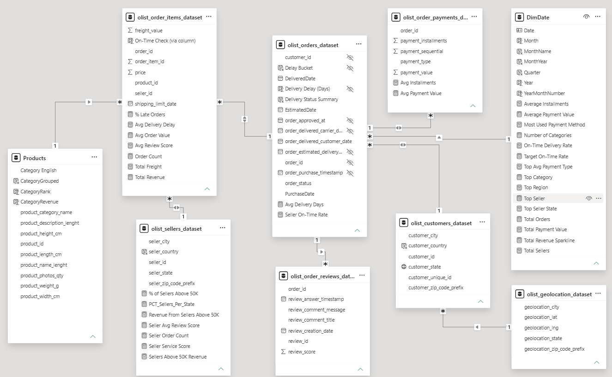
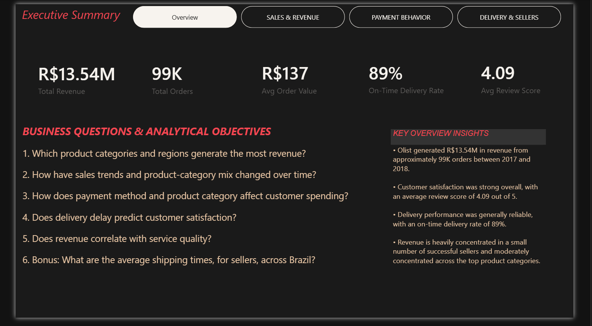
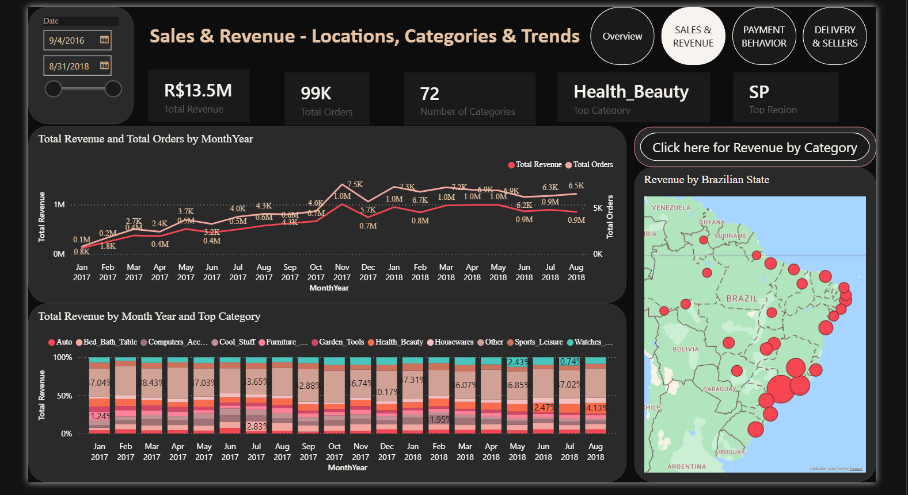
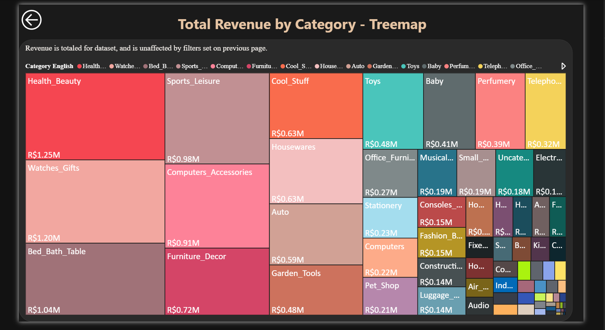
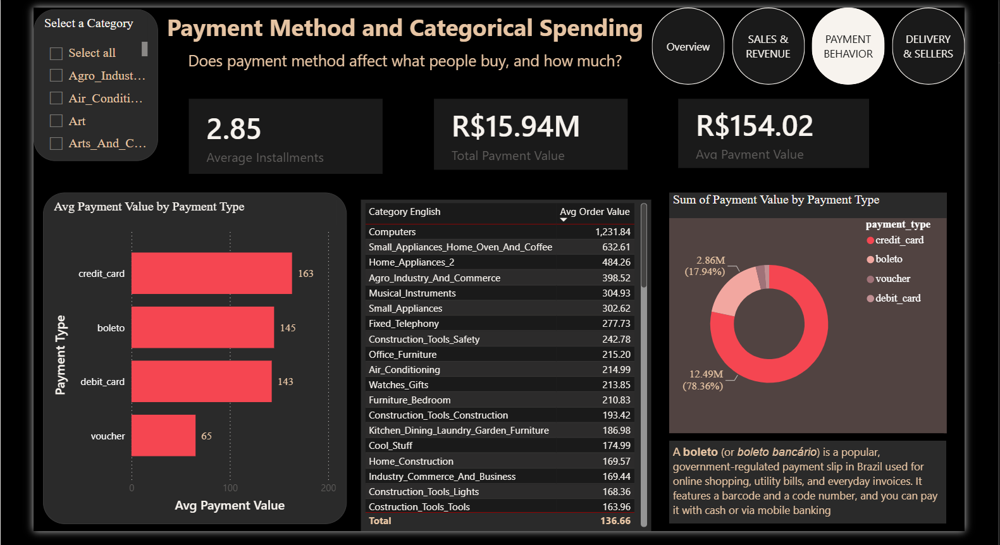
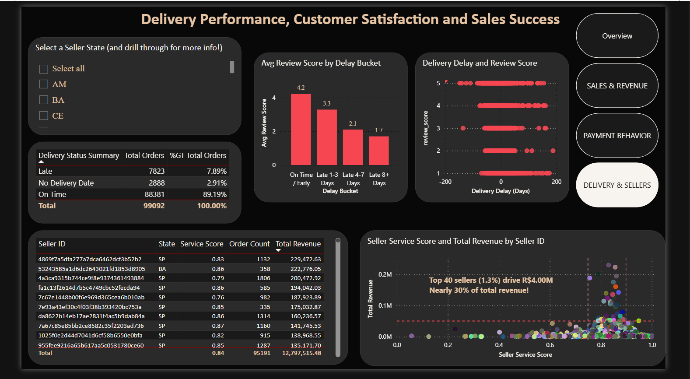
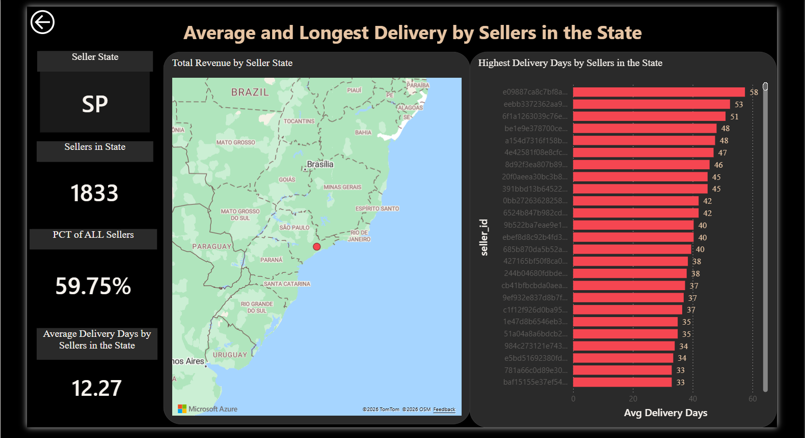
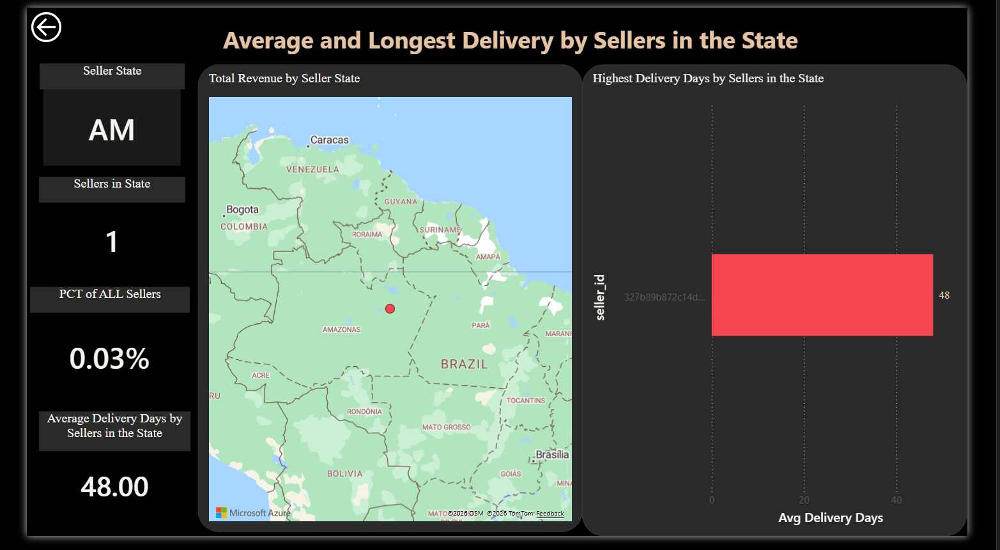

# Olist Marketplace Performance Analysis (Power BI)

An interactive Power BI report built on the public Olist Brazilian e-commerce dataset (about 99,000 orders placed between 2016 and 2018). It asks what drives revenue, where delivery breaks down, and which sellers matter most. The report is built to be explored, with shared slicers, cross-filtering, and drillthrough, instead of one static page per question. This was a group project for DATA 460 at SAIT, following the CRISP-DM process.

**At a glance**

- **My role:** group of five. I took over the data model and report partway through: fixed the model, rebuilt the measures, and reworked the report into an interactive one. Details in [My role](#my-role).
- **Skills shown:** Power Query, data modeling (fact constellation, date table, role-playing dates with `USERELATIONSHIP()`), DAX, interactive report design (cross-filtering, drillthrough), data cleaning and validation, CRISP-DM, written findings and recommendations.
- **Headline findings:**
  - Delivery drives satisfaction: average review score is 4.2 for orders on time or early and 1.7 for orders 8 or more days late.
  - Revenue is concentrated: São Paulo is about 38% of revenue, and 40 of about 3,000 sellers (1.3%) generate 30%.
  - Most orders with no delivery date (2,888, or 2.9%) are canceled, unavailable, or still in process. Only the 1,097 still marked shipped might be lost or late.
- I also document where findings did not hold up. See [Things I ran into](#things-i-ran-into) and [Limitations](#limitations).


## What the report contains

| Page | What it shows |
|------|---------------|
| Overview | Headline KPIs (revenue, orders, average order value, on-time delivery rate, average review score), the six business questions, and navigation |
| Sales & Revenue | Revenue and orders by month, category mix by month, revenue by state, with a button through to a revenue-by-category treemap |
| Payment Behavior | Average and total payment value by payment type, average order value by category, with a category slicer |
| Delivery & Sellers | Delivery status breakdown, review score by delay bucket, a seller leaderboard, and a seller service score vs revenue scatter. Drillthrough from a seller state opens a page of average and longest delivery times for that state's sellers |

Screenshots of every page are in [images/](images/). The written report is in [docs/](docs/DATA460_Final_Project_Description_and_Analysis.pdf) (PDF).

## Business questions and findings

| # | Question | What the report found |
|---|----------|-----------------------|
| 1 | Which product categories and regions drive the most revenue? | Health_Beauty is the top category of 72. The top 11 categories (about 15%) make up roughly two thirds of revenue. São Paulo alone generates over R$5M, about 38% of the total. |
| 2 | How have sales trends and category mix changed over time? | Revenue and orders climbed through 2017, peaking in November 2017, and then held roughly level from January to August 2018. The data ends in August 2018, so the fall ramp-up toward the holidays, where year-over-year growth would show most clearly, is only visible for 2017. Category mix stayed relatively stable month to month. With one holiday season in the data, any seasonal pattern is a hypothesis. |
| 3 | How do payment method and category affect spending? | Credit card is 78.4% of payment value, with an average payment of R$163. Boleto, a Brazilian bank-slip payment, is a distant second. Computers have by far the highest average order value but only about 2% of revenue. |
| 4 | Does delivery delay predict customer satisfaction? | Yes, strongly. Average review score falls from 4.2 (on time or early) to 1.7 (8 or more days late). 89.2% of orders arrive on time, 7.9% are late, and 2.9% (2,888 orders) have no recorded delivery date. That group is a mix of canceled, unavailable, in-process, and still-marked-shipped orders (breakdown under Limitations). |
| 5 | Does revenue correlate with service quality? | The top 1.3% of sellers (40 of about 3,000) generate 30% of revenue (R$4.0M of R$13.5M). Those sellers cluster at a Seller Service Score of roughly 0.75 to 0.9, but so do most sellers: about 80% or more of all sellers score above 0.75, so the score alone does not separate top earners from the rest. |
| Bonus | What are average shipping times for sellers across Brazil? | The platform average is 12.5 days. The single seller in Amazonas averages 48.0 days, against 12.3 days for São Paulo's 1,833 sellers. That illustrates the gap for remote states, but it is one seller, not a state-wide statistic. |

## Data

- **Source:** [Brazilian E-Commerce Public Dataset by Olist](https://www.kaggle.com/datasets/olistbr/brazilian-ecommerce) on Kaggle.
- **Scope:** about 100,000 anonymized orders from 2016 to 2018 across nine relational tables (orders, order items, payments, reviews, products, customers, sellers, geolocation, and a category translation table). Olist anonymized company and reviewer names before release.
- **Date filter:** the report is filtered to January 2017 through August 2018. The 2016 data is a sparse pilot period and the last two months of 2018 are incomplete.
- **Other exclusions:** a negligible number of payment records with an undefined payment type and a value of zero.
- **Currency:** the dataset does not label its currency. Olist sells in Brazil, so I treat all monetary values as Brazilian reais (R$). Monetary values in the report and screenshots are formatted as R$.
- The raw CSVs are not stored in this repo. Download them from Kaggle if you want to refresh the report (see Running it).

## Data model

[](images/00_data_model.png)

*The model in Power BI's model view. Orders sit in the middle and connect to three tables at different grains (order items, payments, reviews). Sellers and products connect through order items, and customers, geolocation, and a date table complete the model.*

What I changed from the raw files:

- **Dates.** Added date-only columns for purchase, delivered, and estimated dates (the raw timestamps include time of day, which breaks a relationship to a date table). Purchase date is the active relationship to `DimDate`, and delivery-specific measures reach the other two with `USERELATIONSHIP()`.
- **Categories.** Merged in the translation table so every visual uses English category names.
- **Geography.** Added an explicit country column and set data categories so Brazilian state codes map to Brazil.
- **Delivery status.** Built a Delivery Status Summary column (On Time, Late, No Delivery Date) so blank delivery dates are handled on purpose.
- **Seller Service Score.** The average of a normalized review score, `(average review - 1) / 4`, and the seller's on-time rate, equally weighted, for sellers with at least 5 orders. The minimum stops a seller with one lucky 5-star order from ranking as perfect.

## Results, page by page

### Overview

[](images/01_overview.png)

### Sales and revenue

[](images/02_sales_and_revenue.png)

*The Sales & Revenue page: revenue and orders by month, category mix over time, and revenue by Brazilian state. Every visual responds to the date slicer and to clicks on the other visuals.*

[](images/03_revenue_by_category_treemap.png)

*Revenue by category, reached from the Sales & Revenue page. As the page itself notes, it is not affected by the filters set on the previous page.*

### Payment behavior

[](images/04_payment_behavior.png)

### Delivery and sellers

[](images/05_delivery_and_sellers.png)

*Review score drops with each delay bucket. The scatter on the bottom right plots seller service score against total revenue, with the top 40 sellers called out.*

[](images/06_drillthrough_seller_state_delivery.png)

*The drillthrough page, shown here for São Paulo (SP). It is reached from the Delivery & Sellers page with a right-click drillthrough.*

[](images/07_drillthrough_amazonas.png)

*The same page for Amazonas (AM): one seller in the state, averaging 48.0 days to deliver, against 12.27 days across São Paulo's 1,833 sellers.*

## Things I ran into

- **Timestamps broke the date relationship.** Purchase and delivery fields carried time of day, so they did not match the date table. Stripping them to dates fixed the relationship.
- **Two on-time rates.** The first on-time delivery measure showed 79% while the validated Delivery Status Summary column showed about 89%. The cause was blank delivery dates being coerced inside a `CALCULATE` boolean comparison. I rebuilt the measure to read the validated column directly.
- **Brazilian states geocoded worldwide.** Two-letter state codes were resolving to places outside Brazil until I added the country column.
- **Drillthrough context leak.** Drilling through from a multi-column table passed extra row context to the target page, while drilling from a state-only visual did not. I used the state-only visual.
- **A pattern that looked stronger than it was.** The scatter suggested the top 40 sellers sit in a tight high-quality band (0.75 to 0.9). Scrolling the full seller table showed that about 80% or more of all sellers score above 0.75, so the band does not set top earners apart. I treat it as context now, not as a finding.
- **A claim that did not hold up.** An initial analysis suggested revenue was concentrated in a small number of categories. Checking showed the top 11 of 72 categories make up about 66%, which is moderate concentration, and much weaker than the seller concentration (1.3% of sellers for 30% of revenue). I reworded for accuracy.

## Limitations

- **The service score does not separate top sellers from the rest.** The top 40 sellers cluster at roughly 0.75 to 0.9, but about 80% or more of all sellers score above 0.75, so a high score is seemingly a requirement for top sellers but is also common and does not by itself explain who earns the most. This is correlation only, not cause. 
- **Overlapping measures.** The Seller Service Score includes on-time rate, and on-time delivery also drives review scores (question 4). Questions 4 and 5 are largely the same mechanism seen from two angles.
- **Reviews belong to orders, not sellers.** In the rare multi-seller order, one review score is attributed to every seller involved.
- **Amazonas is a single seller.** The Amazonas drillthrough covers one seller (0.03% of all sellers), so its 48-day average shows how long a remote delivery can take but is not a state-wide statistic.
- **One holiday cycle.** There is only one full Nov to Dec period (2017), and the data ends in August 2018, so the fall ramp-up to the holidays cannot be compared year over year. Seasonality is not confirmed.
- **"No delivery date" is mostly not a delivery failure.** 2,888 orders (2.9%) have no recorded delivery date. Of these, 579 are canceled, 602 are unavailable, 1,097 are still marked shipped, 602 stopped at invoiced, processing, created or approved, and 8 are marked delivered with a missing date. The dataset can't show whether the shipped orders were lost, delayed, or simply not updated before the data was extracted.
- **Currency is inferred.** The dataset documentation does not state a currency, so R$ is an inference from the data being a Brazilian marketplace.
- **Historical data.** Everything here describes 2017 to 2018 and may not describe the platform today.
- **Screenshots are static.** The interactivity (cross-filtering, drillthrough) only works in the `.pbix` in Power BI Desktop.

## My role

This was a group project. Riley Orman found the dataset, and did some initial investigation, and then the group chose the business questions together. Tony Cherupushpam built the first version of the data model and report and then, at the end, applied the dark theme, fonts and added navigation buttons.  

In between, I took over the model and the report:

- Reviewed and fixed the data model: repaired the date relationship, adjusted bidirectional filters that caused problems, and replaced hardcoded file paths with a single `DataFolderPath` parameter so anyone on the team could repoint the report to their own copy of the data.
- Built the date table and the delivery-date logic using `USERELATIONSHIP()`.
- Debugged and rebuilt measures, including a ranking error and the blank-date bug in the on-time delivery rate.
- Added a Seller Service Score to test whether seller quality relates to revenue. (It showed that the top 40 sellers all score well, but so do most sellers, so the score alone does not explain revenue.)
- Set the report-wide date filter after finding the 2016 and late-2018 data sparse and incomplete.
- Rebuilt the report from one static page per question into an explorable one with cross-filtering and drillthrough, following instructor feedback from earlier versions.
- Wrote the project description and analysis (Word doc) and put together the group presentation (not included here)

## How this was built

I used Claude as a working assistant throughout: reviewing the data model, debugging DAX, collaborating the Seller Service Score design, and drafting the Word report and the group presentation. I directed the analysis, decided what to adopt, tested the results in Power BI, and checked the findings against the data. The group's other members contributed as credited above.

## Running it

- Open `powerbi/olist_powerbi_report.pbix` in Power BI Desktop (Windows). The file is about 37 MB and contains the imported data, so it opens without the CSVs.
- To refresh from source, download the CSVs from Kaggle, then in Power Query set the `DataFolderPath` parameter to the folder that holds them.

```
powerbi/  the Power BI report (.pbix)
docs/     project description and findings report (PDF)
images/   screenshots of each report page and the data model
```

## Tools

Power BI Desktop, Power Query, DAX, Microsoft Word.

## Team

DATA 460 SAIT, Group 1: Riley Orman, Tony Cherupushpam, Emmanuel Eshiwe, David Oluwatobi, and David McVee.


## Data attribution and license

The data comes from the [Brazilian E-Commerce Public Dataset by Olist](https://www.kaggle.com/datasets/olistbr/brazilian-ecommerce), published on Kaggle under [CC BY-NC-SA 4.0](https://creativecommons.org/licenses/by-nc-sa/4.0/).

Changes made: the data was cleaned, joined into a Power BI model, filtered to January 2017 through August 2018, and extended with calculated columns and measures. Olist does not endorse this project.

This repo is for non-commercial, educational, and portfolio use. The Power BI report (which contains the data), the screenshots, and the written report are adaptations of the dataset and are shared under the same CC BY-NC-SA 4.0 license.

## More projects

- [LiDAR canopy and terrain classification](https://github.com/davemcvee/lidar-canopy-classification) (Python, PDAL, CloudCompare)
